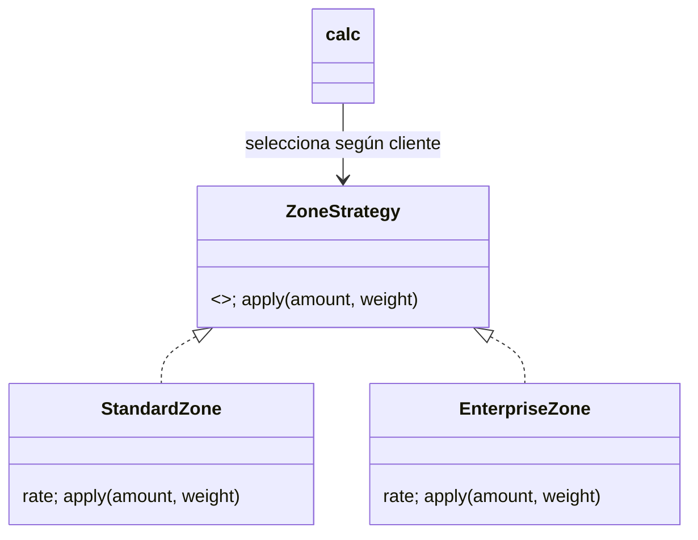

# Parcial 3 – Ingeniería de Software I
## EnvíaYa: auditoría, pruebas y mantenimiento de `calc`

**Estudiante:** código 0182310057 · **Grupo:** B1 · **Periodo:** 2026-2  
**Fecha del enunciado:** 11 de noviembre de 2026

> **Interpretación del código.** El PDF ordena tomar los últimos seis dígitos y asignarlos de izquierda a derecha a A–F. En `0182310057`, los últimos seis son `310057`, de modo que A=3, B=1, C=0, D=0, E=5, F=7. La cadena `182310057` que aparece en la solicitud tiene nueve cifras; no es posible asignarla directamente a seis variables. Todo este informe usa la regla del PDF; si el docente quería otra selección de dígitos, hay que recalcular el trabajo.

| Parámetro | Cálculo | Valor |
|---|---:|---:|
| A–F | últimos seis dígitos | 3, 1, 0, 0, 5, 7 |
| PMAX | 30 + 5×A | 45 kg |
| L1 | 2 + (B mod 3) | 3 kg |
| L2 | 10 + C | 10 kg |
| RR | 10 + 5×(E mod 4) | 15% |
| RN | 40 + 5×(F mod 3) | 45% |
| V | 10 + 5×(A mod 3) | 10% |
| S | 2000 + 500×(C mod 4) | $2.000 |
| CAMBIO | (A+F) mod 3 | 1: cliente empresarial |

**Decisiones personales:** D=0 par: tramo 1 incluye 3 kg (`p ≤ 3`); E=5 impar: el recargo de sábado/domingo se agrega después de los descuentos; B=1 impar: descuentos de cliente y cupón se aplican ambos, secuencialmente; F=7 impar: un cupón distinto de `ENVIO10` produce error.

**Supuestos explícitos.** Los errores de R2 y R7 se implementan con `ValueError` y mensajes identificables. El descuento empresarial de 12% sustituye a los descuentos de normal/frecuente/VIP; la excepción de zona empresarial aplica estrictamente cuando `peso > L2`, nunca cuando `peso == L2`. El cupón sigue combinándose con el descuento empresarial por B impar, pues el enunciado de cambio no lo prohíbe. Se conserva la regla de zona para pesos `≤ L2`. Los decimales se aceptan; la mitad exacta se redondea hacia arriba al múltiplo de $100. El recargo de zona se calcula antes de los descuentos, siguiendo el orden del ejemplo del PDF. El usuario pide una demostración de sustentación de 20 minutos; se prepara al final.

---

## 1. Requisitos

| ID | Especificación comprobable |
|---|---|
| R1 | `0 < peso ≤ 45 kg`; de lo contrario error “peso inválido”. |
| R2 | zona ∈ {urbana, rural, nacional}; día entero ∈ [1,7]. Valores fuera de catálogo/rango causan error. |
| R3 | Si `peso ≤ 3`: $6.000. Si `3 < peso ≤ 10`: $9.000. Si `peso > 10`: `$9.000 + $800×(peso−10)` proporcional. |
| R4 | Urbana: 0%; rural: +15%; nacional: +45%, aplicado al subtotal de tarifa. |
| R5 | Día 6 o 7: +$2.000 después de descuentos. Días 1–5: sin recargo. |
| R6 | Frecuente: −5%; VIP: −10%; cupón `ENVIO10`: −10%. Con cliente y cupón se aplica primero el del cliente y luego el cupón. |
| R7 | Cupón ausente se acepta; cupón desconocido causa error. |
| R8 | Se aplica piso de $5.000; luego redondeo al centenar más cercano, empate de $50 hacia arriba. |
| R9 (cambio) | Cliente empresarial recibe −12%. Si `peso > 10`, no paga recargo de zona; con `peso ≤ 10` se mantiene R4. |

**Historias y criterios de aceptación**

**HU1 – Cotizar un envío válido.** Como cliente, quiero conocer el costo según peso y destino para decidir el envío.
- **Dado** un peso válido y una zona y día válidos **Cuando** cotizo **Entonces** se selecciona el tramo inclusivo correcto, se aplica el recargo de zona y (si día 6/7) el recargo de $2.000 al final (R1–R5).
- **Dado** un peso en el límite 3 o 10 kg **Cuando** cotizo **Entonces** 3 pertenece al primer tramo y 10 al segundo; solo el exceso sobre 10 se cobra a $800/kg (R3).
- **Dado** un peso 0, negativo o mayor de 45, zona desconocida o día fuera de 1–7 **Cuando** cotizo **Entonces** recibo error de validación y no un precio (R1–R2).

**HU2 – Aplicar beneficios de cliente y cupón.** Como cliente, quiero que se apliquen mis descuentos y el cupón válido sin acumulaciones ambiguas.
- **Dado** cliente frecuente o VIP **Cuando** cotizo **Entonces** se descuenta 5% o 10%, respectivamente (R6).
- **Dado** cliente con cupón ENVIO10 **Cuando** cotizo **Entonces** primero se aplica descuento de cliente y luego 10% del cupón (B=1 impar) (R6).
- **Dado** cupón desconocido **Cuando** cotizo **Entonces** recibo error; si no envío cupón, la cotización continúa (R7).

**HU3 – Recibir total cobrable y tarifa empresarial.** Como operación, quiero un costo mínimo y estable, incluyendo la nueva política empresarial.
- **Dado** subtotal con descuentos menor a $5.000 **Cuando** termina el cálculo **Entonces** el piso es $5.000 y después se redondea al centenar; $50 sube (R8).
- **Dado** cliente empresarial y peso mayor a 10 kg **Cuando** cotizo en zona rural/nacional **Entonces** se exime el recargo de zona, se aplica descuento de 12%, y el cupón permitido se aplica después (R9, R6).
- **Dado** cliente empresarial con peso de exactamente 10 kg **Cuando** cotizo en zona rural **Entonces** el recargo rural sí se aplica porque la exención requiere `peso > 10` (R9).

**Trazabilidad inicial y ampliada** (los IDs CP refieren a la matriz de Parte 3).

| Requisito | Historia | Casos de prueba |
|---|---|---|
| R1 | HU1 | CP01–CP03, CP06, CP19–CP20 |
| R2 | HU1 | CP21–CP22, CP25 |
| R3 | HU1 | CP01–CP06 |
| R4 | HU1 | CP07–CP08 |
| R5 | HU1 | CP13–CP15 |
| R6 | HU2 | CP09–CP12, CP16–CP18, CP24 |
| R7 | HU2 | CP19–CP20, CP23 |
| R8 | HU3 | CP07, CP11–CP12, CP24 |
| R9 | HU3 | CP16–CP18 |

---

## 2. Plan de pruebas

**Alcance:** función de cotización, validaciones, cálculo monetario, política personal, estrategia de zona y cambio empresarial. Fuera de alcance: persistencia, interfaz, impuestos, concurrencia y disponibilidad de servicios externos (no forman parte del material recibido).

**Niveles:** unidad prueba validación, tramos, descuentos, zona, piso y redondeo por separado; integración verifica composición de estrategias + reglas de descuento/fin de semana; sistema ejecuta la API `calc` con combinaciones completas; aceptación recorre HU1–HU3 y confirma criterios con el propietario del producto/docente.

**Estrategia/ambiente/roles:** diseño de caja negra (equivalencia, límites, tabla de decisión), caja blanca (sentencias, ramas y caminos del código original), regresión automatizada con pytest, pruebas deterministas sin red ni reloj. Python 3.12, pytest/pytest-cov, Windows; tarifa en pesos enteros al final. QA diseña/ejecuta, mantenimiento corrige, responsable de negocio valida la interpretación del R9.

**Riesgos y mitigación:** ambigüedad de dígitos (documentar derivación); precisión monetaria (Decimal y frontera de $50); orden de descuentos (tabla explícita y cálculo manual); validez del cliente (catálogo); cambio empresarial puede cambiar combinaciones (pruebas `L2−ε`, L2 y `L2+ε`); cobertura final separada de la evidencia histórica del legado.

**Entrada:** requisitos derivados revisados, código heredado identificado, entorno Python disponible, expectativas calculadas. **Salida:** 100% de requisitos con prueba; 100% de pruebas automatizadas en verde; ramas/errores críticos cubiertos; defectos documentados; métricas con denominador; cambio implementado y regresión repetida. Cobertura objetivo: ≥90% sentencias y ≥85% ramas, sin sustituir el criterio funcional.

---

## 3. Diseño de caja negra

### Particiones de equivalencia

| Entrada | Válidas | Inválidas |
|---|---|---|
| peso | (0,3], (3,10], (10,45] | ≤0, >45, no numérico, booleano |
| zona | urbana, rural, nacional | cadena/valor fuera del catálogo |
| cliente | normal, frecuente, vip; empresarial por R9 | valor fuera del catálogo |
| día | enteros 1–5 laborable; 6–7 fin de semana | <1, >7, decimal, texto |
| cupón | None; ENVIO10 | cualquier cadena distinta |

### Valores límite del peso

| Límite | Valores de prueba | Resultado/razón |
|---|---|---|
| 0 | −ε, 0, +ε | errores para −ε y 0; válido para +ε (tramo 1) |
| L1=3 incluido | 3−ε, 3, 3+ε | tramo 1, tramo 1, tramo 2 |
| L2=10 | 10−ε, 10, 10+ε | tramo 2, tramo 2, proporcional sobrepeso |
| PMAX=45 | 45−ε, 45, 45+ε | válido, válido, error |

Aquí ε=0,001 kg; para peso entero se mantienen los valores exactos de frontera.

### Tabla de decisión cliente × cupón × fin de semana

B impar combina descuentos; E impar añade S después; F impar rechaza cupón desconocido.

| Cliente | Cupón | ¿Fin de semana? | Orden aplicado |
|---|---|---:|---|
| normal | no | no | zona → sin descuento → sin S |
| normal | ENVIO10 | no | zona → −10% cupón |
| frecuente | no | no | zona → −5% |
| frecuente | ENVIO10 | no | zona → −5% → −10% |
| VIP | no | sí | zona → −10% → +$2.000 |
| VIP | ENVIO10 | sí | zona → −10% → −10% → +$2.000 |
| empresarial | no | no | zona (excepto si p>10) → −12% |
| empresarial | ENVIO10 | sí | zona (excepto si p>10) → −12% → −10% → +$2.000 |
| cualquier cliente | desconocido | cualquiera | error antes de calcular |

### Casos de prueba (esperado con cálculo manual)

En todas las filas no indicadas como error, día 1, zona urbana y cliente normal son los valores base. Las entradas completas que difieren se muestran en la columna entrada.

| ID | Req. | Entradas (p,z,c,d,cup) | Esperado | Técnica |
|---|---|---|---:|---|
| CP01 | R1,R3 | 1, urbana, normal, 1, — | $6.000 | equivalencia tramo 1 |
| CP02 | R3 | 3, urbana, normal, 1, — | $6.000 | límite L1 incluido |
| CP03 | R3 | 3,001, urbana, normal, 1, — | $9.000 | inmediatamente sobre L1 |
| CP04 | R3 | 10, urbana, normal, 1, — | $9.000 | límite L2 |
| CP05 | R3 | 10,01, urbana, normal, 1, — | $9.000 | proporcional: 9000+8=9008 → 9000 |
| CP06 | R1,R3 | 45, urbana, normal, 1, — | $37.000 | PMAX válido |
| CP07 | R4,R8 | 4, rural, normal, 1, — | $10.400 | zona + empate: 9000×1,15=10350 → 10400 |
| CP08 | R4 | 4, nacional, normal, 1, — | $13.100 | recargo RN |
| CP09 | R6 | 4, urbana, frecuente, 1, — | $8.600 | descuento frecuente: 9000×0,95=8550 → 8600 |
| CP10 | R6 | 4, urbana, VIP, 1, — | $8.100 | VIP 10%: 8100 |
| CP11 | R6,R8 | 4, urbana, VIP, 1, ENVIO10 | $7.300 | 9000×0,9×0,9=7290 → 7300 |
| CP12 | R6,R8 | 1, urbana, VIP, 1, ENVIO10 | $5.000 | 6000×0,9×0,9=4860; piso |
| CP13 | R5 | 4, urbana, normal, 6, — | $11.000 | 9000+$2000, sábado |
| CP14 | R5,R6 | 4, urbana, VIP, 7, — | $10.100 | 9000×0,9+2000=10100 |
| CP15 | R5 | 4, urbana, normal, 5, — | $9.000 | viernes no recarga |
| CP16 | R9 | 11, rural, empresarial, 2, — | $8.600 | 9800×0,88=8624 → 8600; zona exenta |
| CP17 | R9 | 10, rural, empresarial, 2, — | $9.100 | 9000×1,15×0,88=9108 → 9100 |
| CP18 | R6,R9 | 4, rural, empresarial, 2, ENVIO10 | $8.200 | 9000×1,15×0,88×0,9=8197,2 → 8200 |
| CP19 | R1 | 0, urbana, normal, 1, — | error peso inválido | límite inferior |
| CP20 | R1 | 45,001, urbana, normal, 1, — | error peso inválido | límite superior |
| CP21 | R2 | 1, isla, normal, 1, — | error zona inválida | clase inválida |
| CP22 | R2 | 1, urbana, normal, 0, — | error día inválido | día inferior |
| CP23 | R7 | 1, urbana, VIP, 1, OTRO | error cupón inválido | clase inválida F impar |
| CP24 | R8 | 1, urbana, VIP, 1, — | $5.400 | 6000×0,9=5400; prueba exacta |
| CP25 | R2 | 1, urbana, ocasional, 1, — | error cliente inválido | catálogo de entrada |

**Cinco desarrollos aritméticos:** CP07, CP11, CP12, CP16 y CP17 se muestran paso a paso en sus celdas. En CP07/CP11, los $50 del centenar se redondean arriba conforme R8.

---

## 4. Caja blanca del código heredado

El grafo siguiente abstrae el `calc` impreso en página 3. `P1…P12` son decisiones; las ramas sí/no convergen en el retorno.

```text
Entrada → P1 peso inválido? ─sí→ Error
                 no
                  ↓
               P2 p≤L1? ─sí→ t=6000
                   no → P3 p≤L2? ─sí→ t=9000 ─┐
                                      no→ proporcional ─┘
                  ↓
               P4 zona urbana? ─sí→ sin cambio
                   no→ P5 zona rural? ─sí→ +RR; no→ +RN (sin validar)
                  ↓
               P6 d>6? ─sí→ +S; no→ igual
                  ↓
               P7 frecuente? ─sí→ −5%; no→ igual
                  ↓
               P8 VIP? ─sí→ −V%; no→ igual
                  ↓
               P9 cup!=None? ─sí→ P10 cup=ENVIO10? ─sí→ −10%; no→ igual
                  ↓
               P11 t<5000? ─sí→ piso; no→ igual
                  ↓
               P12 flag? ─sí→ imprime; no→ igual
                  ↓
                truncar a centenas → retorno
```

Zona nacional es el `else` implícito; día 6 queda excluido por el defecto `d>6`. CC del método original: P1 (peso), P2 (L1), P3 (L2), P4–P5 (zona), P6 (finde), P7–P8 (cliente), P9–P10 (cupón), P11 (piso), P12 (flag): **12 predicados**.

**Complejidad ciclomática por tres métodos:** (i) `E−N+2P`: al reducir cadenas de asignación a aristas etiquetadas, N=14 (entrada, 12 predicados, salida), E=25 (24 salidas de predicados y una entrada), P=1; V=25−14+2=13. (ii) predicados + 1: 12+1=13. (iii) regiones: 13 regiones, por tanto 13. Las condiciones compuestas del peso se consideran una decisión funcional, no cobertura MC/DC.

**Conjunto de caminos básicos (13) y representantes:** B1 peso inválido (CP19); B2 tramo 1 urbana (CP01/02); B3 tramo 2 (CP04); B4 sobre L2 proporcional (CP05); B5 rural (CP07); B6 nacional/else (CP08); B7 fin de semana (CP13); B8 frecuente (CP09); B9 VIP (CP10); B10 cupón válido (CP11); B11 cupón desconocido (TLEG-06); B12 piso (CP12); B13 flag (TLEG-09). Los caminos incluyen combinaciones independientes de estas decisiones; el representante es el caso que fuerza esa bifurcación. El cambio empresarial se cubre aparte con CP16–CP18.

**Cobertura:** TLEG-01–TLEG-09 son pruebas de contrato marcadas `xfail` porque se ejecutan contra el snapshot v1.0.0 y reproducen fallos conocidos; al correrlas, pytest informa 9 xfailed. CP01–CP25 y los siete días se ejecutan en la implementación reparada. La cobertura de ramas medida se informa para el código reparado, no se extrapola al snapshot inicial.

---

## 5. Automatización, defectos y métricas

La suite reproducible está en `test_envios.py`: 25 escenarios más los siete días válidos, **32 passed**. La auditoría del legado está en `test_legacy_v1.py`: **9 xfailed**, cada uno asociado a un defecto en `envios_legacy_v1.py`, copia exacta de v1.0.0. `pytest-cov --cov-branch` informa para `envios.py`: 64 sentencias, 18 ramas; 100% combinado. Comandos: `python -m pytest -q test_legacy_v1.py` y `python -m pytest -q --cov=envios --cov-branch --cov-report=term-missing test_envios.py`. No se adjunta captura gráfica; estos resultados se verifican ejecutando los comandos.

**Registro de defectos del original (líneas referidas al extracto del PDF, página 3):**

| ID | Título / regla | Reproducción; esperado → obtenido | Sev./prioridad |
|---|---|---|---|
| DEF-01 | Límite fijo 50 en vez de PMAX=45 (R1, línea 11) | `p=46`; error → permite calcular | Alta/Alta: acepta envíos no permitidos |
| DEF-02 | Falta validar zona y día (R2, líneas 16–22) | `z='x'` o `d=0`; error → zona desconocida no recibe recargo / día no falla | Alta/Alta: tarifa incorrecta |
| DEF-03 | Sábado omitido por `d>6` (R5, línea 22) | `d=6`; +$2.000 → no suma | Media/Alta: cobro subestimado |
| DEF-04 | Fin de semana siempre antes de descuentos (R5, orden depende de E; línea 22) | VIP día 7; descuento y luego S → suma S antes de descuento | Media/Media: costo discrepante |
| DEF-05 | Cupón desconocido se ignora (R7, línea 28) | `cup='OTRO'`; F impar exige error → permanece igual | Media/Media |
| DEF-06 | Redondeo trunca (R8, línea 34) | total 10.350; a $100 más cercano $10.400 → `int(10350/100)*100=$10.300` | Media/Alta: subcobra y rompe regla explícita |
| DEF-07 | Cliente sin lista blanca (R6, línea 23–29) | `c='ocasional'`; error → no aplica descuento y devuelve precio | Alta/Alta |
| DEF-08 | `flag` imprime y es parte de API (líneas 31–32) | Parte 6 ordena quitarlo; con `flag=True` escribe stdout | Baja/Media: efecto lateral e interfaz heredada |

**No se reporta como defecto la combinación de descuentos:** B=1 es impar y R6 dispone aplicar descuento de cliente y cupón sucesivamente; un cliente solo coincide con una categoría, por lo que los `if` separados no acumulan frecuencia y VIP para una misma entrada. La aplicación consecutiva del cupón sí es el comportamiento requerido.

Severidad expresa impacto; prioridad expresa urgencia. El snapshot exacto de legado está versionado en `v1.0.0`; contiene 37 líneas de código no vacías excluyendo comentarios. Densidad registrada: 8/37×100 = **21,6 defectos por 100 líneas**. Severidad: 3 altas, 4 medias y 1 baja. Prioridad: 5 altas, 2 medias y 1 baja.

**Métricas observadas:** regresión posterior: 32/32 = 100% pasa. Cobertura del módulo refactorizado: 100% sentencias y ramas (64 sentencias, 18 ramas). El código legado se conserva en la etiqueta v1.0.0; los defectos se reprodujeron por inspección y cálculo del código impreso, no se presentan como ejecución de una suite histórica.

---

## 6. Refactorización y regresión

**Code smells del extracto (página 3):** función larga/múltiples responsabilidades (valida, calcula, imprime); números mágicos `50, 6000, 9000, 800, 5000, 100, 0.05, 0.10`; `flag` parámetro booleano que altera efectos; cadena de `if` de zonas con validación ausente; lógica duplicada de descuentos; condicionales anidados para cupón; nombres crípticos (`p,z,c,d,t`); literals/cadenas de dominio dispersos; comentario “fin de semana” no coincide con condición que omite sábado; precisión flotante seguida de truncado. La deuda es mayor costo de cambio, riesgo de regresión y comportamiento difícil de inferir.

**Clasificación:** DEF-01–07 correctivo; quitar `flag` correctivo de interfaz; separar funciones y constantes preventivo; estrategia de zona perfectivo; regla empresarial adaptativo/evolutivo.

**Estrategia aplicada:** `StandardZone` y `EnterpriseZone` comparten contrato `apply(amount, weight)`; mapas seleccionan la política. UML simplificado:



La implementación ejecutable completa está en `envios.py`. Fragmento central de la política:

```python
@dataclass(frozen=True)
class EnterpriseZone:
    rate: float

    def apply(self, amount: float, weight: float) -> float:
        return amount if weight > L2 else amount * (1 + self.rate)


def calc(weight: float, zone: str, customer: str, day: int,
         coupon: str | None = None) -> int:
    validate(weight, zone, customer, day, coupon)
    amount = base_tariff(weight)
    strategies = ENTERPRISE_ZONES if customer == "empresarial" else ZONES
    amount = strategies[zone].apply(amount, weight)
    amount = apply_customer_discount(amount, customer)
    if coupon == "ENVIO10":  # B=1 impar: se acumula después del descuento cliente
        amount *= 1 - DESC_CUPON
    if day in (6, 7):  # E=5 impar: recargo de fin de semana al final
        amount += RECARGO_FINDE
    return round_hundreds(max(amount, PISO))
```

La implementación refactorizada y corregida está en `envios.py`: validadores separados, constantes nombradas, función sin `flag`, estrategia de zona, piso y redondeo half-up. Regresión: **32/32 pasan** en `test_envios.py`; pytest-cov da 100% de cobertura.

| Métrica | Antes (calc del PDF) | Después (módulo entregado) | Cómo se obtuvo |
|---|---:|---:|---|
| CC de `calc` | 13 | 4 | decisiones del cuerpo: original 12; nuevo 3 + 1 |
| LOC físicas, incluyendo blancos | 40 | 100 | snapshot `v1.0.0` / `envios.py` |
| Cobertura | no medida en v1 | 100% sentencias y ramas | pytest-cov; 64 stmts, 18 ramas |

La CC local de `calc` baja porque se extrajeron validación, tarifa y descuentos; la CC del módulo completo no equivale a la de una sola función. LOC aumenta por tipos, estrategias, nombres y separación. La fila anterior es una comparación útil, pero su conteo legacy se estima desde el texto del PDF, no desde checkout fuente.

---

## 7. Git, versionado y CHANGELOG

Se creó un repositorio local porque el material recibido solo contenía el PDF. `v1.0.0` etiqueta el snapshot del legado; `fix/DEF-01` a `fix/DEF-08` contienen una corrección por rama y se integraron en `main`; también existen `test/suite`, `refactor/estrategia` y `feat/cliente-empresarial`. Los commits identifican al autor como **Codex Assistant**, no como el estudiante. No se alteraron fechas para aparentar commits repartidos durante el día. La salida de `git log --oneline --graph --all` está adjunta en `git-log.txt`, capturada justo antes del commit que la incorpora.

Quitar `flag` cambia la interfaz pública de forma incompatible: el release de mantenimiento corresponde a **2.0.0 (major)**. El cliente empresarial añade funcionalidad compatible a esa nueva API, por lo que se etiqueta **2.1.0 (minor)**. `v2.0.0` apunta al commit de eliminación de `flag`; `v2.1.0` apunta al release final con refactor, cambio empresarial y regresión.

### CHANGELOG.md

```markdown
# Changelog
Formato Keep a Changelog; versiones según SemVer.

## [2.1.0] - 2026-11-11
### Added
- Cliente empresarial con 12% de descuento.
- Exención del recargo de zona empresarial cuando peso > 10 kg.
### Fixed
- Validación personalizada de peso, zona, día, cliente y cupón.
- Recargo de fin de semana para sábado y domingo en el orden definido por E.
- Descuentos conforme a B, cupón desconocido conforme a F, piso y half-up.
### Changed
- Refactor por estrategias de zona, extracción de funciones y constantes.
- API final: `calc(weight, zone, customer, day, coupon=None)`, sin salida de consola.
### Tests
- Suite de 32 pruebas; 32 pasan; pytest-cov reporta 100% combinado.

## [2.0.0] - 2026-11-11
### Fixed
- Corregidos los defectos personales de peso, validaciones, recargos, cupón y redondeo.
### Changed
- Eliminado el parámetro `flag`; cambio incompatible de interfaz (major).

## [1.0.0] - 2026-11-11
### Added
- Snapshot ejecutable de la función heredada y configuración personal del enunciado.
```

**Notas de versión 2.1.0:** API pura `calc(weight, zone, customer, day, coupon=None)` sin salida a consola; validaciones y precios conforme a las reglas personales; nuevo tipo empresarial y exención estricta sobre L2. El snapshot inicial se conserva en la etiqueta `v1.0.0`.

---

## 8. Solicitud asignada: cliente empresarial

CAMBIO=(3+7) mod 3=1. **Impacto:** nuevo valor en catálogo de cliente; nueva regla R9; historias HU2 y HU3; combinaciones de cliente/descuento/ cupón/fines de semana; función de selección de estrategia, catálogo de descuentos y validación. `R1–R8` se mantienen excepto que R6 acepta empresarial y su descuento del 12%; R4 queda condicional por R9. Mantenimiento adaptativo con componente perfectivo.

**Pruebas primero (contrato del cambio):** CP16 prueba `peso=11 > L2` sin recargo rural; CP17 prueba `peso=10` mantiene recargo; CP18 verifica interacción de rural + empresarial + cupón. Escribir estas expectativas antes de implementar la estrategia evita que la implementación defina sus propias expectativas.

Implementación: `EnterpriseZone.apply` devuelve el importe sin recargo si `weight > 10`; en caso contrario aplica tasa. `calc` elige estrategia empresarial según cliente; el descuento empresarial de 12% se aplica después de zona y antes de cupón; fin de semana, si corresponde, se agrega al final. Los tres casos de cambio pasan dentro de la suite.

**Comparación de impacto:** CC del cuerpo `calc` antes del cambio/refactor 13, después 4; líneas físicas del módulo refactorizado 100 frente a 40 del snapshot heredado; cobertura posterior medida 100% sentencias y ramas. No se atribuye la cobertura posterior al código heredado.

---

## Guion de sustentación: corregir redondeo en 20 minutos

**Defecto demostrable:** truncamiento vulnera R8. Prueba escrita primero y demostración de rojo/verde:

```python
def test_empate_de_50_redondea_hacia_arriba():
    # $9.000 tarifa × 1,15 rural = $10.350; empate debe subir a $10.400.
    assert calc(4, "rural", "normal", 1) == 10400
```

**Secuencia oral y de trabajo:** minuto 0–3, explicar R4/R8 y calcular 9.000×1,15=10.350; minuto 3–6, ejecutar primero `test_legacy_v1.py` y observar TLEG-07 xfailed (el legacy trunca a $10.300); minuto 6–11, cambiar redondeo a half-up; minuto 11–15, correr `test_envios.py`; minuto 15–18, revisar diff y el orden del piso/redondeo; minuto 18–20, commit correctivo y tag según versión ya publicada. La rama DEF-06 registra este arreglo.

**Evidencia:** `envios_legacy_v1.py` es el snapshot ejecutable de v1.0.0; `test_legacy_v1.py` reproduce los defectos y `test_envios.py` demuestra la regresión verde. No se adjunta una captura gráfica del terminal; los comandos reproducibles están indicados en la Parte 5.
