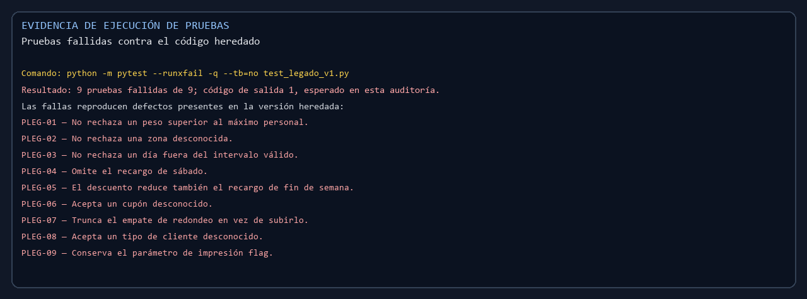
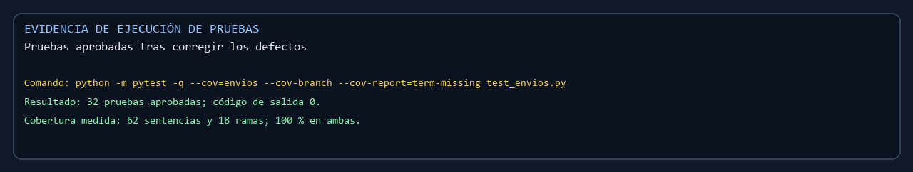

# Evidencias de ejecución de pruebas

Las imágenes presentan en español los resultados reales obtenidos al ejecutar pytest. Se conserva cada identificador de prueba para mantener la trazabilidad. Los resúmenes de texto y las imágenes se generan automáticamente con `generar_capturas.py`.

## Código heredado

La auditoría muestra nueve fallos reproducibles en la versión heredada. El código de salida 1 es el resultado esperado en esta comprobación, porque las pruebas exponen los defectos.

## Código corregido

La regresión termina con código de salida 0: 32 pruebas aprobadas, 62 sentencias y 18 ramas cubiertas, con 100 % de cobertura.

## Reproducción

Instalar `pytest`, `pytest-cov` y `Pillow`. Ejecutar `python evidencias/generar_capturas.py` desde la carpeta principal. El generador ejecuta ambas suites, comprueba los resultados y vuelve a crear los resúmenes y capturas.
